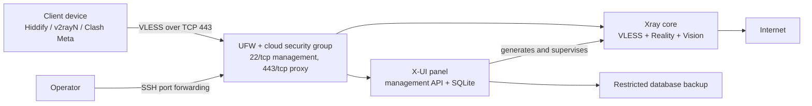

# Architecture

## Components

| Component | Responsibility | Boundary |
| --- | --- | --- |
| X-UI | Management UI, client lifecycle, traffic counters, Xray configuration | Management-only; do not expose publicly by default |
| Xray core | Handles encrypted client connections and outbound traffic | Public proxy port only |
| SQLite database | Stores panel settings, inbounds, and client metadata | Host-mounted, backup required |
| UFW/cloud firewall | Limits inbound exposure | Default deny inbound |
| Backup script | Archives the X-UI database | Local, permission-restricted, restore must be tested |

## Request flow

1. An approved client connects to the server's proxy port with VLESS + Reality.
2. Xray validates the Reality handshake and client UUID.
3. Xray forwards permitted traffic to the destination.
4. X-UI records client and traffic metadata in SQLite.
5. Operators reach the panel through an SSH tunnel or an explicit management allowlist.

## Design constraints

- A 1 GiB VPS is suitable for a small lab or small team, not a large company-wide gateway.
- Multiple public IPs do not multiply CPU, memory, or purchased bandwidth. They are useful for separation, failover, or independent listener policy.
- `network_mode: host` is used because Xray owns host ports directly. `NET_ADMIN` is required by the upstream container for some client/IP-limit features; review this privilege before production use.
